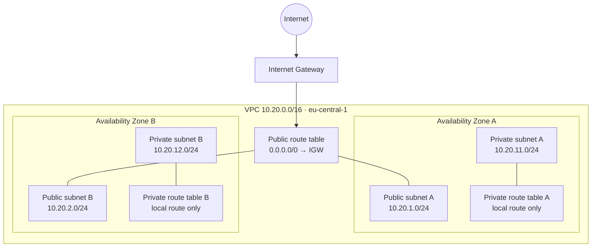

# AWS Enterprise Network Automation

A portfolio project that translates enterprise networking fundamentals into secure, repeatable AWS infrastructure as code. It demonstrates a two-Availability-Zone VPC, deterministic routing, isolated private subnets, credential-free tests, and read-only CI.

> **Portfolio scope:** this is a personal learning and demonstration project created by a network engineer transitioning into Cloud/DevOps. It is not evidence of a production AWS deployment. Version 1 has not been deployed by this repository and CI never applies or destroys infrastructure.

## Design objectives

- Preserve clear Layer 3 boundaries and explicit route ownership.
- Keep private subnets isolated from direct Internet access.
- Default to no billable AWS resources: no NAT Gateway, VPN, compute, Flow Logs, or endpoints.
- Make address plans, region, and Availability Zones configurable.
- Validate structure without AWS credentials or infrastructure changes.
- Keep operationally complex controls, such as restrictive NACLs, evidence-driven.

## Architecture



The module dynamically selects the first two available Availability Zones unless an explicit pair is supplied. A subnet is called public because its associated route table has an Internet Gateway route; workloads still need an explicitly assigned public address and appropriate security policy to communicate with the Internet.

## Resource inventory

| Resource | Quantity | Purpose | Billable by itself? |
|---|---:|---|---|
| VPC | 1 | Regional network boundary | No |
| Subnet | 4 | Public/private tiers across two AZs | No |
| Internet Gateway | 1 | Public IPv4 routing target | No hourly charge |
| Route table | 3 | One public and two isolated private tables | No |
| Security group | 1 | Private HTTPS-only example policy | No |
| NAT Gateway, VPN, compute, Flow Logs | 0 | Planned extensions only | Not deployed |

### Address plan

| Tier | AZ index | CIDR | Public IPv4 auto-assign | Default route |
|---|---:|---|---|---|
| Public | A | `10.20.1.0/24` | Disabled | `0.0.0.0/0 → IGW` |
| Public | B | `10.20.2.0/24` | Disabled | `0.0.0.0/0 → IGW` |
| Private | A | `10.20.11.0/24` | Disabled | None |
| Private | B | `10.20.12.0/24` | Disabled | None |

Each private subnet has its own route table to support future per-AZ NAT or hybrid-routing changes without disruptive table replacement. In v1, those tables contain only the AWS-created local route. The public subnets share one public route table.

## Security model

- No SSH (`22`) or RDP (`3389`) ingress exists.
- The example application security group allows TCP/443 only within the VPC, in both directions. Real workloads should reference security groups where possible and narrow egress to actual destinations.
- Public IP auto-assignment is disabled on all subnets. Public placement is therefore an explicit workload decision.
- Private route tables have no Internet Gateway or NAT default route.
- Default NACL behavior is retained deliberately; see [Network ACL strategy](docs/NETWORK_ACLS.md).
- Terraform uses the ambient AWS credential chain. No keys, account IDs, or secrets belong in Git.
- Required tags identify project, environment, management method, and repository; optional tags can add ownership or cost allocation.

This project does not create IAM roles. For an approved deployment, use short-lived federation/OIDC and a reviewed least-privilege provisioning role. Separate planning from deployment approval and scope permissions to the required EC2 networking APIs.

## Repository structure

```text
.
├── .github/workflows/terraform-ci.yml
├── docs/
│   ├── HYBRID_VPN.md
│   ├── NETWORK_ACLS.md
│   ├── TEST_RESULTS.md
│   └── TROUBLESHOOTING.md
├── modules/network/
│   ├── main.tf
│   ├── outputs.tf
│   ├── variables.tf
│   └── versions.tf
├── scripts/static_network_tests.py
├── modules/network/tests/network.tftest.hcl
├── main.tf, providers.tf, variables.tf, outputs.tf, versions.tf
└── terraform.tfvars.example
```

## Local validation

Prerequisites: Terraform `1.7+`, Python `3.9+`, and optionally TFLint and Checkov.

```bash
terraform fmt -check -recursive
terraform init -backend=false
terraform validate
terraform -chdir=modules/network test
python scripts/static_network_tests.py
tflint --init
tflint --recursive
checkov -d . --framework terraform
```

The native tests use Terraform's mock provider and explicit AZ values. The Python tests independently check subnet containment/non-overlap, route intent, public-IP behavior, and absence of open SSH/RDP rules. Neither requires AWS credentials.

## Optional deployment — manual approval only

No deployment is required to review this project. If you choose to deploy it in your own sandbox account, first review the code and current AWS pricing:

```bash
cp terraform.tfvars.example terraform.tfvars
terraform init
terraform plan -out=tfplan
# Inspect the plan carefully. Apply only through your own approved process.
terraform apply tfplan
```

This repository and its GitHub Actions workflow deliberately contain no automatic `apply` or `destroy`. Never commit `terraform.tfvars`, plan files, state, `.terraform/`, credentials, or private keys.

For a team environment, replace local state with an approved remote backend. A typical AWS design uses an encrypted, versioned S3 bucket, state locking, restricted bucket policies, audit logging, and a dedicated bootstrap process. Backend resources and configuration are intentionally outside v1 so validation remains self-contained.

## CI/CD and supply-chain posture

GitHub Actions runs on pull requests and pushes to `main` with read-only repository permissions. It executes formatting, initialization without a backend, validation, native/static tests, TFLint, and Checkov. It never authenticates to AWS.

Actions are pinned to maintained major versions for readability and automated maintenance. Production repositories should pin third-party actions to reviewed full commit SHAs and use dependency automation to propose upgrades. Treat every action as executable code and grant only the permissions it needs.

## Cost and cleanup warning

The declared v1 network primitives generally have no hourly charge, but AWS pricing changes and traffic-related charges can still apply. Public IPv4 addresses are billable. NAT Gateways have hourly and data-processing charges; Site-to-Site VPN and Transit Gateway have hourly/data charges; Flow Logs incur log ingestion/storage costs; endpoints, compute, Reachability Analyzer, and cross-AZ/data-transfer usage may also cost money.

This project has not run `terraform apply`. If you manually deploy it, inspect the state and plan before cleanup:

```bash
terraform plan -destroy
terraform destroy
```

Confirm deletion in the AWS console and check for separately created resources, public IPv4 addresses, logs, and storage. Destruction is never automated because it is irreversible and requires owner approval.

## Connectivity verification after a real deployment

- Confirm route-table associations and targets using the VPC console or AWS CLI.
- Confirm private tables contain no `0.0.0.0/0` route.
- Confirm all subnets have public IPv4 auto-assignment disabled.
- Use temporary, approved test workloads and VPC Reachability Analyzer where justified.
- Verify both forward and return paths, security groups, NACLs, DNS, host firewalls, and application listeners.

See the detailed [troubleshooting runbook](docs/TROUBLESHOOTING.md).

Recorded local evidence is available in [test results](docs/TEST_RESULTS.md). CI results should be treated as pending until the repository is published and GitHub Actions completes.

## Limitations and roadmap

Implemented in v1: VPC, four subnets, Internet Gateway, public/private routing, a restricted example security group, tags, outputs, static/native tests, and read-only CI.

Planned only: NAT Gateway, VPC endpoints, compute, custom NACLs, Flow Logs, centralized inspection, IPv6, multi-account topology, Transit Gateway, Direct Connect, and redundant Site-to-Site VPN. The [hybrid VPN design](docs/HYBRID_VPN.md) records the intended direction without claiming implementation.

## Design discussion and interview prompts

1. **Why two AZs?** To demonstrate fault-domain separation while keeping the portfolio topology small and understandable.
2. **Why separate private route tables?** They support future AZ-local egress and reduce shared routing blast radius.
3. **Why no NAT Gateway?** Private Internet egress is not required for the baseline and NAT introduces real hourly/data cost.
4. **Why retain the default NACL?** Security groups are stateful and workload-oriented; restrictive stateless rules require a proven traffic matrix and operational justification.
5. **Does an IGW route make a host reachable?** No. The workload also needs a public address, permissive security controls, a listening service, and valid return routing.
6. **How would hybrid routing be protected?** Validate non-overlapping prefixes, use BGP with redundant tunnels, control propagation, monitor tunnel health, and test asymmetric-failure cases.
7. **How should Terraform state evolve?** Move it through an approved migration to encrypted remote storage with locking, versioning, least privilege, and recovery procedures.

## Portfolio summary

This repository demonstrates the ability to translate enterprise routing, segmentation, change control, and troubleshooting practices into Terraform modules and CI guardrails. It intentionally distinguishes completed code from future architecture and makes no claim of a live production deployment.

## License

MIT — see [LICENSE](LICENSE).

