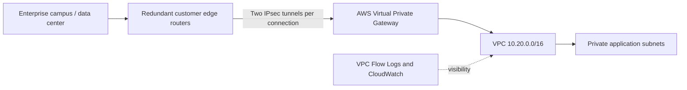

# Future Hybrid VPN Architecture

This document describes a future extension and is not deployed by version 1.

A portfolio extension could model redundant AWS Site-to-Site VPN connections, BGP routing, route propagation, on-premises prefix allowlists, tunnel monitoring, and failover validation. Larger multi-VPC estates should evaluate Transit Gateway. Direct Connect may be appropriate for predictable bandwidth and latency, with VPN as backup.

Before implementation, validate CIDR uniqueness across every site, BGP ASN ownership, encryption domains, MTU/MSS, DNS forwarding, asymmetric-routing risks, and responsibility for incident response. Site-to-Site VPN, Transit Gateway, Direct Connect, logging, and data transfer are billable services.

